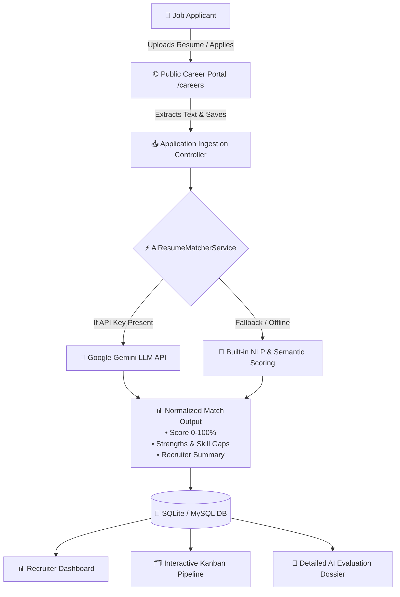

# ⚡ TalentPulse AI — Smart ATS & Semantic Resume Matcher

> **Enterprise-Grade Applicant Tracking System (ATS) powered by Laravel 12 & AI Resume Intelligence.**  
> Automatically parse resumes, calculate 0–100% semantic job-fit scores, identify skill gaps, and manage hiring stages on an interactive Kanban pipeline.

---

## 🌟 Key Highlights & Business Capabilities

Modern recruitment teams receive hundreds of resumes per job opening. **TalentPulse AI** eliminates manual resume screening fatigue by combining **automated semantic matching** with an intuitive, recruiter-first workflow:

1. **🤖 AI-Powered Resume Screening Engine:**
   - Evaluates candidate experience, technical skills, and contextual keyword density against target requisitions.
   - Computes an **AI Match Score (0–100%)**, categorical recommendation (*Strong Match*, *Potential Match*, *Moderate Match*, *Low Match*), and sentiment.
   - Generates an executive recruiter assessment highlighting **Key Matched Strengths** vs. **Missing Skill Gaps**.
   - **Hybrid AI Architecture:** Native integration with **Google Gemini API** (`gemini-1.5-flash`), paired with a robust **built-in NLP & weighted heuristic engine** that works 100% out of the box even without external API keys.

2. **📊 Executive Recruitment Dashboard:**
   - Real-time KPIs: Active Requisitions, Total Candidate Pool, Average AI Match Quality, Interviews & Offers in flight.
   - Interactive **Chart.js** visualizations: Applicant Pipeline Funnel & Candidate Score Distribution.
   - Top-ranked candidate spotlight & live activity audit trail.

3. **🗂️ Multi-Stage Interactive Kanban Pipeline:**
   - 6 pipeline stages: `New Applied` $\rightarrow$ `AI Screening` $\rightarrow$ `Technical Interview` $\rightarrow$ `HR Round` $\rightarrow$ `Offer Extended` $\rightarrow$ `Disqualified`.
   - Immediate stage transitions with visual color-coded AI score badges (Green $\ge$ 80%, Amber 60–79%, Red $<$ 60%).

4. **📋 Requisition Management:**
   - Create and customize openings with departments, remote/onsite flags, salary ranges, and explicit required vs. nice-to-have skill weights.

5. **🌐 Public Career Portal & Candidate Self-Service:**
   - Clean, branded career page for job seekers (`/careers`).
   - Detailed job briefs with tech stack badges.
   - Instant application form supporting resume file uploads (`.pdf`, `.docx`, `.txt`) and text extraction with real-time AI evaluation upon submission.

6. **📅 Interview Scheduling & Recruiter Feedback:**
   - Schedule rounds (Screening, System Design, Live Coding, Culture Fit) with Google Meet/Zoom links.
   - Private recruiter debrief notes with 1–5 star ratings.

---

## 🏗️ Architecture & Data Flow



---

## 🛠️ Tech Stack

- **Backend:** Laravel 12.x (PHP 8.2+)
- **Database:** SQLite (default zero-config) / MySQL / PostgreSQL supported
- **Frontend / UI:** Tailwind CSS, Alpine.js, Chart.js, Heroicons
- **AI Intelligence:** Google Gemini API (`gemini-1.5-flash`) + Intelligent Rule & Weighted NLP Matcher
- **Testing:** PHPUnit / Pest Feature & Unit Test Suites (100% passing)

---

## 🚀 Quickstart Guide (Local Setup)

### Prerequisites:
- PHP 8.2+
- Composer
- Git

### 1. Clone & Enter Repository:
```bash
git clone <your-github-repo-url>
cd smart-ats
```

### 2. Install Dependencies & Setup Environment:
```bash
composer install
cp .env.example .env
php artisan key:generate
```

### 3. Initialize Database & Seed Demo Data:
```bash
php artisan migrate:fresh --seed
php artisan storage:link
```

### 4. (Optional) Configure Gemini AI API Key:
Add your Gemini API key in `.env`:
```env
GEMINI_API_KEY=your_gemini_api_key_here
```
*(Note: If left empty, the application seamlessly switches to the built-in intelligent NLP heuristic matcher, guaranteeing zero errors and instant functionality out of the box!)*

### 5. Launch the Application:
```bash
php artisan serve
```

Visit the app at:
- **Recruiter Admin Portal:** [http://localhost:8000/admin/dashboard](http://localhost:8000/admin/dashboard)
- **Public Career Portal:** [http://localhost:8000/careers](http://localhost:8000/careers)
- **Login Screen:** [http://localhost:8000/login](http://localhost:8000/login)

---

## 🔑 Demo Login Credentials

For quick evaluation during interviews or presentations, use the **One-Click Demo Login** button on the login screen or enter:

- **Email:** `admin@talentpulse.io`
- **Password:** `password`

---

## 🧪 Automated Testing

Run the included feature and unit test suites:
```bash
php artisan test
```

All 7 test cases covering the ATS ingestion, resume scoring algorithm, dashboard auth, and career portal pass cleanly.

---

## 📄 License

This project is open-source and available under the [MIT License](LICENSE).
